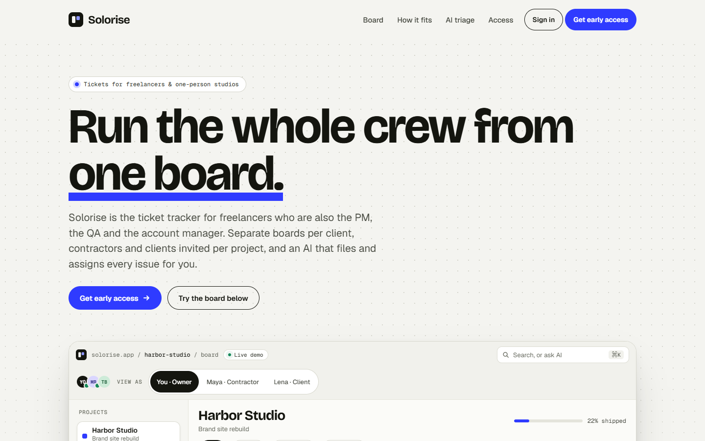
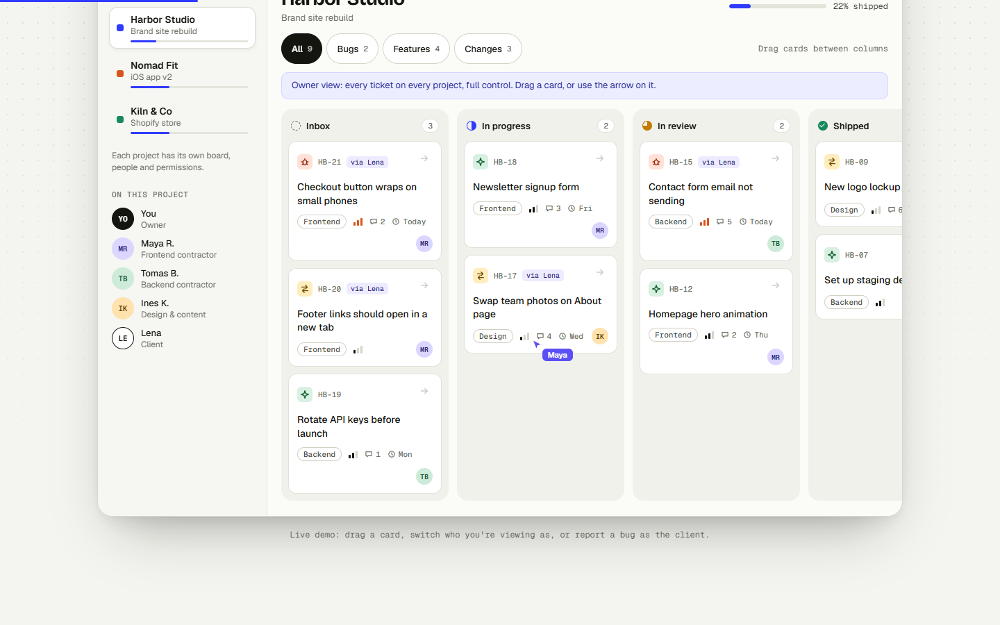
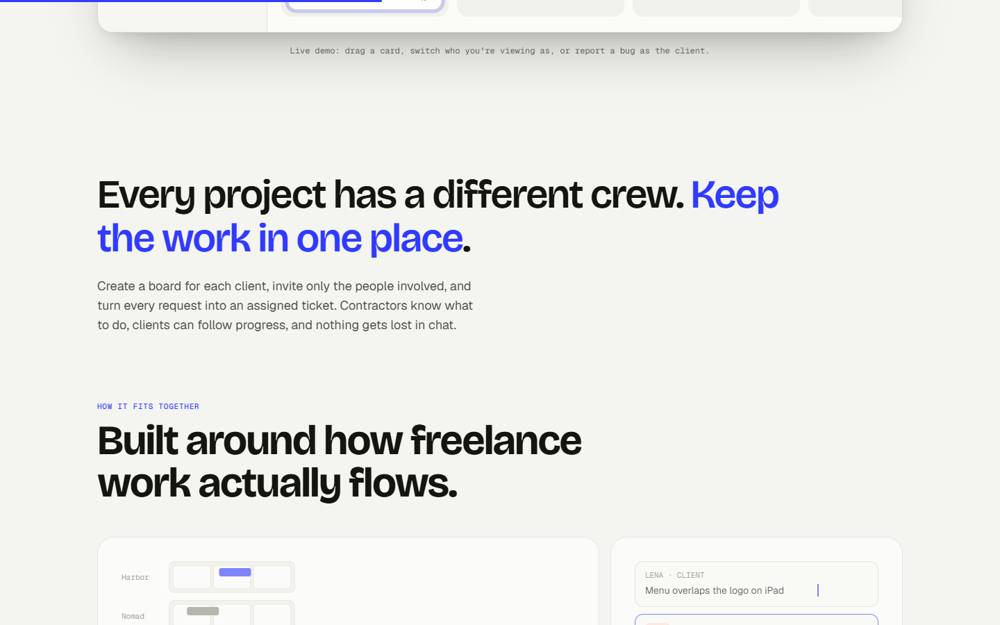
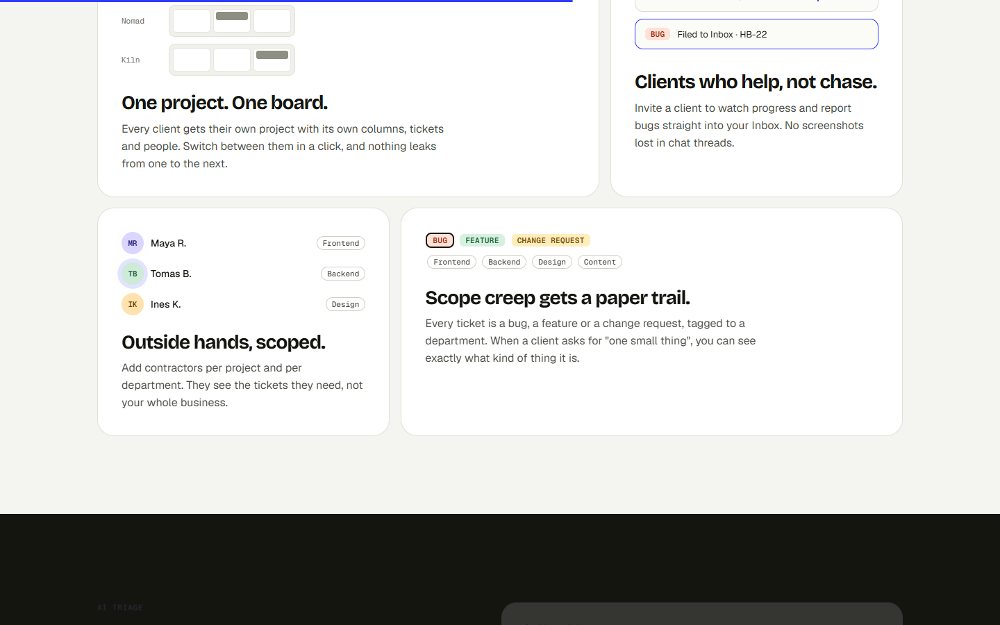
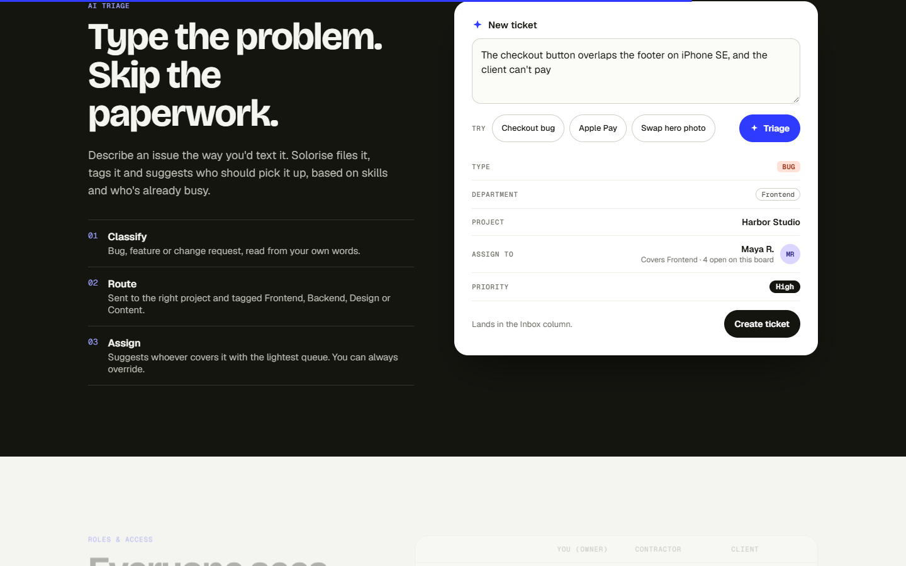
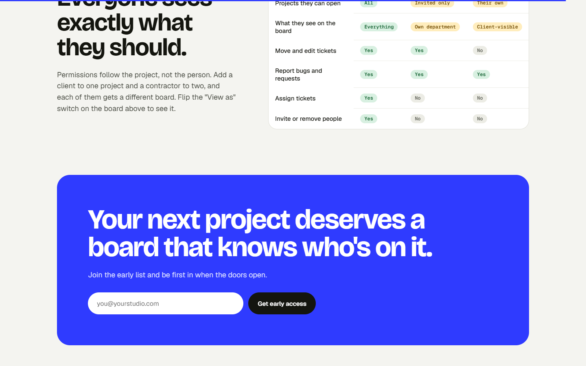
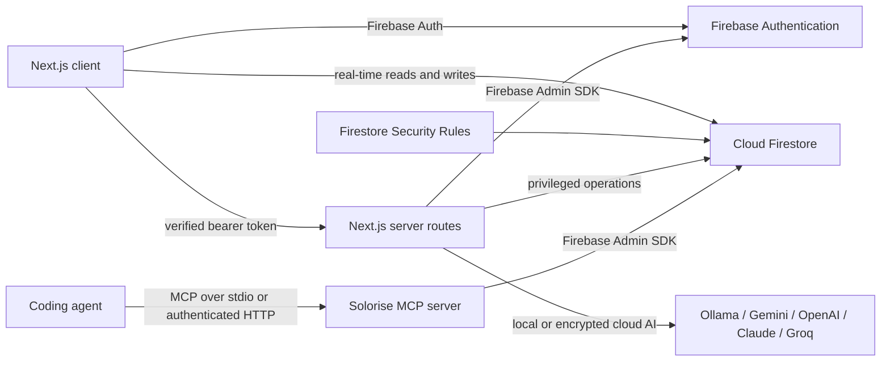

# Solorise

**AI-assisted project and ticket management for freelancers, contractors, and client-facing studios.**

[](https://nextjs.org/)
[](https://firebase.google.com/)
[](https://ollama.ai/)
[](https://github.com/dastageerb/solorise)
[](https://modelcontextprotocol.io/)
[](./LICENSE)

Solorise gives a one-person business the structure of a product team without pretending that every project has a full-time department behind it. Create separate project boards, invite contractors and clients only where they belong, manage real tickets, and use AI—running 100% locally with Ollama or connected to Google Gemini, OpenAI, Anthropic Claude, Groq, or DeepSeek—to turn a rough issue into a categorized, assignable ticket.

It is also an agent-ready work system, not merely a tracker with an AI label: the bundled MCP server exposes real project and ticket workflows to compatible coding agents, while the in-app assistant can answer project questions and turn rough requests into reviewed tickets.

## Landing page walkthrough

The screenshots below show the complete public experience from the opening message through the final call to action.

### 1. Product positioning



### 2. Interactive multi-project board



### 3. A workflow designed for freelance projects



### 4. Scoped collaboration and accountable change requests



### 5. AI-powered ticket triage



### 6. Role-based access and final call to action



## Why Solorise

Most issue trackers assume a permanent company structure. Freelance work is different: the team changes per project, clients need selective visibility, specialists may work across several boards, and the owner is often the PM, QA lead, and account manager at the same time.

Solorise is built around that reality:

- One deployment and Firebase project per owner or organization
- Separate access lists for every project
- Admin, contractor/member, and client roles
- Client-visible tickets without exposing internal work
- Real-time Firestore boards with persistent local cache
- AI-powered ticket triage using local models (Ollama) or your own API key (Gemini, Claude, OpenAI, Groq, DeepSeek)
- Conversational Ask AI answers board-grounded questions about pending bugs, open tickets, priorities, and progress
- Project-specific AI Scope Harness ("Guidelines for AI") to prevent misplaced tickets across projects
- A first-party MCP server lets external coding agents discover, update, and complete project work
- Solo-operator mode: automatically assigns tickets to the admin when working without a team
- No seeded product data—the authenticated workspace starts empty
- An interactive landing-page board that remains separate from production data

## AI-assisted ticket triage

The AI flow is designed to reduce ticket-administration work, not replace project decisions.

1. A signed-in user describes an issue in plain language.
2. The user sets an **AI Scope & Project Harness** for each project (defining what belongs in-scope, out-of-scope, and routing guidelines).
3. A protected server route sends the request to the configured AI provider:
   - **Local Models (Ollama, LM Studio, vLLM)**: Runs 100% locally on your machine with zero data leakage. Automatically detects installed models (`llama3.2`, `mistral`, `deepseek-r1`, `qwen`, etc.) without requiring an API key.
   - **Cloud Providers**: Google Gemini, OpenAI (`gpt-4o-mini`, etc.), Anthropic Claude (`claude-3-5-sonnet`, etc.), Groq (`llama-3.3-70b`), DeepSeek, OpenRouter, or any custom OpenAI-compatible endpoint.
4. The AI proposes a concise title, description, ticket type, department, priority, and best-fit assignee (or defaults to the Admin in solo-operator mode).
5. **Cross-Project Scope Detection**: If the request matches another project's scope, the AI prompts with a clarification (*"Does this ticket belong to Project X instead?"*) with one-click project switching.
6. The user reviews and edits the suggestion before saving it to Firestore.

### Conversational project Q&A

The **Ask project** tab reads the current project snapshot and answers follow-up questions such as “What bugs are still pending?”, “What is in progress?”, or “What should I prioritize next?”. Answers are generated by the configured LLM, are limited to projects the signed-in editor can access, and cite ticket keys when discussing specific work. Ticket content is treated as untrusted context, and the assistant cannot silently mutate board data.

API keys are never shipped in the browser bundle. Cloud keys stored through the admin Settings screen are encrypted with authenticated AES-256-GCM before being written to Firestore. Local Ollama models require no API key at all.

## Model Context Protocol (MCP) — Autonomous Agent Integration

Solorise includes a production-ready **Model Context Protocol (MCP)** server ([`scripts/mcp-server.mjs`](./scripts/mcp-server.mjs)) built on `@modelcontextprotocol/sdk`. This allows autonomous coding agents—such as **Claude Desktop, Cursor, Windsurf, Claude Code CLI, or Codex**—to read, claim, plan, and resolve tickets directly on your Solorise board.

### What an agent can do via MCP
1. **Discover work**: `solorise_list_projects` and `solorise_list_tickets` let an agent see pending backlog tasks, priorities, and project guidelines.
2. **Read ticket context**: `solorise_get_ticket` retrieves the exact problem statement, acceptance criteria, and project-specific AI rules.
3. **Move workflow lanes**: `solorise_update_ticket_status` shifts a ticket from `backlog` -> `progress` when starting, and moves it to `review` or `done` with an explanation note once verified.
4. **Draft implementation plans**: `solorise_update_ticket` and `solorise_add_checklist_item` let an agent attach its proposed execution plan and step-by-step checklist.
5. **Report follow-up items**: `solorise_create_ticket` allows an agent to file newly discovered subtasks or bugs directly into the board.

### Connecting Claude Desktop or Cursor (Zero Hosting Needed)

Open your `claude_desktop_config.json` (or your Cursor MCP settings) and point it to your local Solorise clone. Replace `/absolute/path/to/solorise` with the absolute path where you cloned the repository (Windows paths may use forward slashes, for example `C:/path/to/solorise`):

```json
{
  "mcpServers": {
    "solorise": {
      "command": "node",
      "args": [
        "/absolute/path/to/solorise/scripts/mcp-server.mjs"
      ]
    }
  }
}
```

#### In Zed Editor (`~/.config/zed/settings.json`)
```json
{
  "context_servers": {
    "solorise": {
      "command": "node",
      "args": ["/absolute/path/to/solorise/scripts/mcp-server.mjs"]
    }
  }
}
```

#### For Network / Web Agents (OpenCode, LangChain, Custom Bots)
HTTP / Server-Sent Events (SSE) mode is opt-in and binds to loopback by default:
```bash
node --env-file=.env.local scripts/mcp-server.mjs --http --port 3333
```
Endpoint: `http://localhost:3333/sse` (Messages: `http://localhost:3333/messages`).

The recommended local integration is stdio (`npm run mcp`), because it creates no listening network port. The MCP process loads Firebase Admin credentials and therefore acts with privileged server authority; keeping `.env.local` out of Git protects the secret file, but it does **not** make an exposed MCP endpoint harmless. Anyone who can reach an unprotected MCP server could use the authority already loaded into that process.

To intentionally expose HTTP beyond the local machine, set all of the following and place the service behind TLS and a firewall:

```dotenv
MCP_HOST=0.0.0.0
MCP_PORT=3333
MCP_AUTH_TOKEN=generate-a-long-random-secret
MCP_ALLOWED_ORIGINS=https://your-agent-console.example
```

Non-loopback HTTP startup is refused unless `MCP_AUTH_TOKEN` is present. Browser origins are denied unless explicitly listed in `MCP_ALLOWED_ORIGINS`. The health endpoint remains public and exposes no credentials or board data.

### Universal Model Support (100% Dynamic)

The MCP server adheres strictly to open JSON-RPC standards and requires no per-model registration. You can pair it with **any** LLM provider or local weights:
- **Local Open Models**: DeepSeek (R1, V3), Qwen 2.5 Coder, Llama 3.3, Mistral (via Ollama, LM Studio, or vLLM).
- **Cloud APIs**: Google Gemini, Anthropic Claude, OpenAI, Kimi (Moonshot), MiniMax, DeepSeek, or Groq.

### Verify your MCP server
You can verify the connection, schema, and live Firestore tools at any time:
```bash
npm run mcp:test
```

This integration test creates and removes a temporary Firestore project, so run it only against a development workspace or after reviewing the script.

## Features

### Public experience

- Responsive product landing page
- Interactive demo board for explaining the workflow
- Clear route into administrator-provisioned sign-in
- Portfolio-ready product presentation and motion

### Authentication and workspace

- Closed workspace: only administrators create member and client accounts
- Firebase email/password login with no public signup page
- Password-reset flow
- Protected board, people, and settings routes
- Trusted admin authorization through Firebase custom claims
- Empty-state onboarding for the first real project

### Projects and tickets

- Multiple isolated project boards
- Project-specific editors and clients
- Ticket creation, editing, deletion, search, and filtering
- Backlog, in-progress, review, and done workflow
- Drag-to-move tickets between workflow lanes
- Bug, feature, and change-request categories
- Department, priority, due date, labels, assignee, and checklist fields
- Explicit client-visibility control per ticket
- Real-time Firestore subscriptions
- IndexedDB persistence and multi-tab cache synchronization

### Administration

- Create member/contractor and client accounts
- Generate strong temporary passwords and copy a ready-to-share credential bundle
- Grant people access only to selected projects
- Store, replace, or remove encrypted AI keys (or connect directly to local Ollama with zero key required)
- Bootstrap the first administrator from a local script
- No client-side access to Firebase Admin credentials

## Roles and permissions

| Role | Workspace capabilities | Project access |
| --- | --- | --- |
| `admin` | Create projects and accounts, manage access, configure AI providers and models, manage all tickets | All projects owned by the workspace |
| `member` | Work on tickets in assigned projects | Projects listed in `accessIds`; editing requires inclusion in `editorIds` |
| `client` | Follow approved progress and report or review scoped work | Assigned projects; only tickets with `clientVisible: true` are readable |

Admin authority comes from a signed Firebase custom claim. Changing a Firestore profile field to `role: "admin"` does **not** grant administrator access.

## Technology

| Layer | Implementation |
| --- | --- |
| Web application | Next.js 16 App Router, React 19, TypeScript |
| Authentication | Firebase Authentication with email/password |
| Database | Cloud Firestore with real-time listeners |
| Local cache | Firestore persistent IndexedDB cache with multi-tab coordination |
| Server authorization | Firebase Admin SDK and verified bearer tokens |
| AI | Multi-provider: Local Ollama (auto-detected), Google Gemini, OpenAI, Anthropic Claude, Groq, DeepSeek, OpenRouter, or custom endpoints |
| Agent integration | Model Context Protocol server over local stdio or authenticated HTTP/SSE |
| Secret protection | Server-only environment variables and AES-256-GCM encryption |
| Deployment | Vercel, Netlify, or any compatible Node.js host |

## Application architecture



The public landing page uses a self-contained demo. The authenticated product reads only from the connected Firebase project and never copies demo records into Firestore.

## Firestore data model

```text
users/{uid}
  uid, email, displayName, role, createdAt

projects/{projectId}
  name, description, slug, color, ownerId
  triageInstructions (AI Scope Harness), accessIds[], editorIds[], clientIds[], createdAt

projects/{projectId}/tickets/{ticketId}
  issueKey, title, description, column, priority
  type, department, assigneeId, clientVisible
  dueDate, tagIds[], checklist[], reporterId
  order, createdAt, updatedAt, completedAt

systemSecrets/ai
  provider, model, encryptedKey, baseUrl, updatedAt, updatedBy
```

[`firestore.rules`](./firestore.rules) enforces membership, editor access, client-visible ticket filtering, and a complete browser-side denial for `systemSecrets`.

## Routes

| Route | Purpose |
| --- | --- |
| `/` | Public landing page and interactive demo |
| `/login` | Email/password login and password reset |
| `/board` | Protected, Firestore-backed project boards |
| `/team` | Admin people and access management |
| `/settings` | Firebase status and AI provider / local model management |
| `/api/admin/users` | Admin-only account listing and creation |
| `/api/admin/local-models` | Admin-only, allowlisted probing of local model endpoints |
| `/api/admin/ai-key` | Admin-only AI provider configuration, key encryption, and removal |
| `/api/ai/triage` | Authenticated AI ticket classification and conversational project Q&A |

## Requirements

- Node.js 20.9 or newer; Node.js 22 is recommended
- A Firebase project with Authentication and Firestore enabled
- A Firebase service account for bootstrap and server routes
- Optional: Ollama or a supported cloud LLM key for AI triage and conversational Ask AI

## Local setup

### 1. Install the project

```bash
git clone YOUR_REPOSITORY_URL
cd solorise
npm install
cp .env.example .env.local
```

PowerShell equivalent:

```powershell
Copy-Item .env.example .env.local
```

### 2. Create and configure Firebase

In the Firebase Console:

1. Create or select a Firebase project.
2. Add a Web app and copy its configuration values.
3. Open **Authentication → Sign-in method** and enable **Email/Password**.
4. Create a Cloud Firestore database.
5. Open **Project settings → Service accounts** and generate a private key.
6. Copy the service account's project ID, client email, and private key into the server-only environment variables below.

Firebase Web API configuration is public by design. Authorization is enforced by Firebase Authentication, server token verification, and Firestore Security Rules. Service-account credentials are private and must never use a `NEXT_PUBLIC_` prefix.

### 3. Configure environment variables

Use [`.env.example`](./.env.example) as the template.

| Variable | Required | Exposure | Purpose |
| --- | --- | --- | --- |
| `NEXT_PUBLIC_REPOSITORY_URL` | No | Browser | Adds direct Clone and README links to an unconfigured deployment |
| `NEXT_PUBLIC_FIREBASE_API_KEY` | Yes | Browser | Firebase Web SDK configuration |
| `NEXT_PUBLIC_FIREBASE_AUTH_DOMAIN` | Yes | Browser | Firebase Authentication domain |
| `NEXT_PUBLIC_FIREBASE_PROJECT_ID` | Yes | Browser | Firebase project ID |
| `NEXT_PUBLIC_FIREBASE_STORAGE_BUCKET` | Yes | Browser | Firebase storage bucket identifier |
| `NEXT_PUBLIC_FIREBASE_MESSAGING_SENDER_ID` | Yes | Browser | Firebase sender ID |
| `NEXT_PUBLIC_FIREBASE_APP_ID` | Yes | Browser | Firebase Web app ID |
| `NEXT_PUBLIC_FIREBASE_MEASUREMENT_ID` | No | Browser | Optional Analytics measurement ID |
| `FIREBASE_ADMIN_PROJECT_ID` | Yes | Server only | Firebase Admin project ID |
| `FIREBASE_ADMIN_CLIENT_EMAIL` | Yes | Server only | Service-account client email |
| `APP_ENCRYPTION_KEY` | Yes for Settings key storage | Server only | Encrypts stored cloud AI keys (AES-256-GCM) |
| `AI_PROVIDER` | Optional | Server only | Cloud or local provider (`ollama`, `gemini`, `openai`, `anthropic`, `groq`, `deepseek`, `openrouter`, `custom`) |
| `AI_MODEL` | Optional | Server only | Model identifier (e.g. `llama3.2`, `gpt-4o-mini`, `gemini-2.5-flash`) |
| `AI_API_KEY` | Optional | Server only | Direct deployment-level AI key (not required for Ollama) |
| `AI_BASE_URL` | Optional | Server only | Custom endpoint (e.g. `http://localhost:11434` or custom reverse proxy) |
| `GEMINI_API_KEY` | Optional | Server only | Legacy environment-level Gemini key fallback |
| `LOCAL_MODEL_ALLOWED_HOSTS` | Optional | Server only | Comma-separated exact hosts allowed for model discovery beyond loopback |
| `MCP_HOST` / `MCP_PORT` | Optional | Server only | HTTP MCP bind address and port; defaults to `127.0.0.1:3333` |
| `MCP_AUTH_TOKEN` | Required for remote MCP HTTP | Server only | Bearer token protecting MCP endpoints |
| `MCP_ALLOWED_ORIGINS` | Optional | Server only | Comma-separated browser origins allowed to call MCP HTTP endpoints |

Generate a strong application encryption key:

```bash
node -e "console.log(require('crypto').randomBytes(32).toString('base64'))"
```

Keep `APP_ENCRYPTION_KEY` stable after saving an AI key. Changing it makes an existing encrypted value unreadable.

### 4. Deploy Firestore Rules

```bash
npx firebase-tools login
npx firebase-tools use YOUR_FIREBASE_PROJECT_ID
npx firebase-tools deploy --only firestore:rules
```

You may also paste [`firestore.rules`](./firestore.rules) into the Firebase Console Rules editor and publish it there.

### 5. Bootstrap the first administrator

Temporarily add the owner values to `.env.local`:

```dotenv
SOLORISE_ADMIN_EMAIL=owner@example.com
SOLORISE_ADMIN_PASSWORD=replace-with-a-strong-password
SOLORISE_ADMIN_NAME=Workspace owner
```

Run:

```bash
npm run bootstrap:admin
```

The script creates the Authentication account when it does not exist. For an existing account, it updates the display name and password. It then applies the trusted `{ admin: true, role: "admin" }` custom claims and writes the matching `users/{uid}` profile.

Remove `SOLORISE_ADMIN_PASSWORD` immediately after the command succeeds. If the account was already signed in, sign out and back in to refresh its ID token.

### 6. Run Solorise

```bash
npm run dev
```

Open:

- Landing page: `http://localhost:3000`
- Login: `http://localhost:3000/login`
- Product: `http://localhost:3000/board`

The first admin starts with an empty workspace and creates the first project. Solorise does not seed dummy records into the authenticated board.

## Unconfigured public deployments

It is safe to deploy the landing page before connecting Firebase. If the required `NEXT_PUBLIC_FIREBASE_*` values are absent, `/login`, `/board`, `/team`, and `/settings` display a self-hosting screen instead of attempting authentication.

That screen explains that the deployment has no shared backend and asks visitors to run their own copy. Set this optional public variable to turn its generic clone instructions into direct repository links:

```dotenv
NEXT_PUBLIC_REPOSITORY_URL=https://github.com/dastageerb/solorise
```

Local `.env.local` values are intentionally not uploaded by Git or automatically copied to Vercel/Netlify. When you are ready to activate the hosted product, add each required value separately in the hosting provider's environment-variable settings and redeploy.

## Agent-assisted setup

If you prefer not to configure the project by hand, clone Solorise and open the local folder in a trusted coding agent. Ask the agent to read this README and [`.env.example`](./.env.example) before it changes anything.

You can use this prompt:

```text
Set up this Solorise clone for my own Firebase project by following README.md and
.env.example. Keep every private value only in .env.local or my hosting provider's
server-side environment settings. Never print, commit, or place a Firebase Admin
private key, APP_ENCRYPTION_KEY, Gemini key, or password in client code. Guide me
through any Firebase Console steps I must perform, deploy firestore.rules, generate
the encryption key, bootstrap the first admin, run the security checks, typecheck,
and production build, then tell me exactly what remains for deployment.
```

Use an agent running against your local clone or a private workspace. Do not paste service-account JSON contents or production keys into a public issue, public chat, screenshot, or README. If the agent needs a service-account file, place it in a filename already covered by `.gitignore`, let the agent transfer the required values into `.env.local`, and remove the standalone JSON afterward.

## AI provider and local model configuration

Solorise supports both local privacy-first models and major cloud AI providers.

### Option 1: Local models via Ollama (Zero API key required)

For complete privacy with zero external API calls:

1. Install and run [Ollama](https://ollama.ai) on your machine:
   ```bash
   ollama pull llama3.2
   ollama serve
   ```
2. Open `/settings` in Solorise and select **Ollama (Local Models)**.
3. Click **↻ Auto-detect models**. Solorise probes `http://localhost:11434`, automatically discovers your installed models, and displays parameter and memory metrics (e.g. `llama3.2:3b (3.2B · 1.9GB)`).
4. Select your model and click **Save configuration** (no API key needed).
5. Also works with **LM Studio**, **LocalAI**, and **vLLM** under the **Custom / Local** provider option.

### Option 2: Cloud AI providers via Admin Settings screen

1. Set `APP_ENCRYPTION_KEY` in `.env.local` or hosting environment variables.
2. Sign in as workspace admin and open `/settings`.
3. Choose your provider:
   - **Google Gemini** (default: `gemini-2.5-flash`)
   - **OpenAI** (default: `gpt-4o-mini`)
   - **Anthropic Claude** (default: `claude-3-5-sonnet-latest`)
   - **Groq** (default: `llama-3.3-70b-versatile`)
   - **DeepSeek** (default: `deepseek-chat`)
   - **OpenRouter** (default: `openai/gpt-4o-mini`)
   - **Custom / OpenAI-compatible** (with custom base URL)
4. Enter your API key and save. Solorise encrypts the key with AES-256-GCM before writing to `systemSecrets/ai`. Firestore Rules deny browser reads/writes, ensuring the key is never exposed.

### Option 3: Deployment environment variables

Alternatively, set `AI_PROVIDER`, `AI_MODEL`, `AI_API_KEY`, and optional `AI_BASE_URL` in `.env.local` or in your hosting provider's environment variables.

## Local cache and offline behavior

Firestore uses persistent IndexedDB caching with multi-tab coordination. Previously loaded project data can remain available during temporary network loss, and open tabs share the same local cache lease.

This also means project data is stored on the signed-in device. Use trusted devices for sensitive client work and sign out when using a shared computer.

## Deployment

### Vercel

1. Import the GitHub repository.
2. Keep the detected Next.js framework preset.
3. Add all required variables from `.env.example` under **Project Settings → Environment Variables**.
4. Do not add the one-time bootstrap password after the admin exists.
5. Deploy and add the production domain to Firebase Authentication's authorized domains.

### Netlify

1. Import the GitHub repository.
2. Use Netlify's current Next.js runtime integration.
3. Add the same variables under **Site configuration → Environment variables**.
4. Add the deployed domain to Firebase Authentication's authorized domains.

Firebase Web variables alone allow browser sign-in. The `FIREBASE_ADMIN_*` variables are also required for account management, token verification in server routes, encrypted secret storage, and AI triage authorization.

## Security notes

- Admin privileges use Firebase custom claims, not an editable Firestore role alone.
- Public signup is removed. Administrators provision accounts, and Firestore denies the user directory to any Firebase identity without an admin-created workspace profile.
- Privileged API routes verify Firebase ID tokens with the Admin SDK.
- Firestore Rules enforce project access and client-visible ticket filtering.
- Gemini and Firebase Admin credentials remain server-side.
- Keep the Firebase browser key restricted to Firebase APIs; use a separate server-only key for the Gemini Developer API.
- Stored Gemini keys use authenticated AES-256-GCM encryption.
- `.env*` files and service-account JSON filenames are ignored by Git.
- Local server logs, PEM/key files, Firebase CLI state, and common credential JSON filenames are ignored by Git.
- Never commit a service-account JSON file, `.env.local`, or an application encryption key.
- `.gitignore` protects Git commits; it does not remove secrets from a manually created ZIP archive or revoke an already exposed key.
- Rotate a Firebase service-account key immediately if it is accidentally committed or publicly shared.
- AI triage verifies both the Firebase ID token and edit access to the requested project before reading the Gemini key.
- Local-model discovery requires an administrator token, follows no redirects, and accepts only loopback hosts plus exact hosts explicitly listed in `LOCAL_MODEL_ALLOWED_HOSTS`.
- MCP stdio is the safest default. Remote HTTP requires bearer authentication; use TLS, a firewall, and an origin allowlist as additional layers.
- For an internet-facing production deployment, consider Firebase App Check and a platform-level rate limit in addition to Authentication and Firestore Rules.
- Run `npm audit --omit=dev` before production releases.

## Before the first GitHub push

This downloaded project folder is not automatically a Git repository. Initialize it, stage through Git so ignore rules are applied, and inspect the staged file list before publishing:

```bash
git init
npm run security:check
git add .
git status --short
git ls-files | grep -E '(^|/)(\.env|.*firebase-adminsdk.*\.json|service-account.*\.json|.*\.(pem|key))$'
```

The final command should print nothing. On PowerShell, use:

```powershell
git ls-files | Select-String -Pattern '(^|/)(\.env|.*firebase-adminsdk.*\.json|service-account.*\.json|.*\.(pem|key))$'
```

Review the complete `git status` output before committing. Do not publish the directory as a raw ZIP because Git ignore rules are not applied to ZIP contents.

## Useful scripts

```bash
npm run dev              # Start the development server
npm run typecheck        # Validate TypeScript without emitting files
npm run build            # Create the optimized production build
npm start                # Run the production build
npm run security:check   # Scan source and browser bundles for leaked secrets
npm run bootstrap:admin  # Create or promote the first administrator
npm run mcp              # Start the local stdio MCP server
npm run mcp:test         # Exercise the live MCP project/ticket lifecycle
```

## Repository structure

```text
src/app/                 Next.js pages and protected API routes
src/components/          Product, authentication, board, and editor UI
src/lib/firebase/        Firebase client/admin initialization and models
public/                  Landing-page assets and standalone demo document
scripts/                 First-admin bootstrap script
docs/assets/             README and portfolio images
firestore.rules          Project and ticket authorization rules
firebase.json            Firebase CLI configuration
.env.example             Safe environment-variable template
```

## Verification before publishing

```bash
npm run typecheck
npm run build
npm run security:check
npm audit --omit=dev
npm audit
```

Also verify login, password reset, first-project creation, project access, client-visible tickets, admin user creation and credential copying, AI triage, conversational Ask AI, and sign-out/sign-in claim refresh against a non-production Firebase project.

## License

Released under the [MIT License](./LICENSE).
